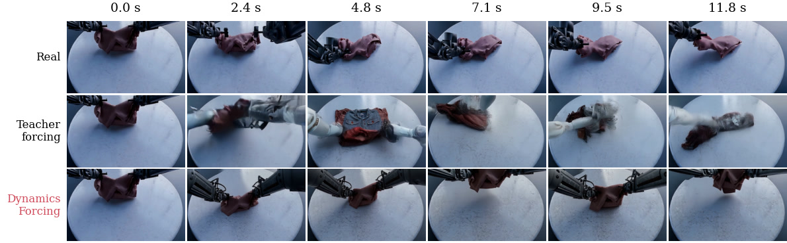
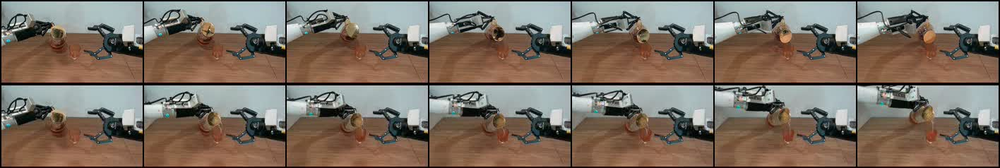

# Dynamics Forcing

Dynamics Forcing trains causal video world models to generate future blocks from a reference image, an instruction, and their own previously generated blocks. It targets the accumulation of rollout errors that occurs when teacher-forced models encounter their own imperfect predictions at inference.

## Method and results

Training uses real video as the target. Random history noise teaches the model to recover from degraded context. Self-resampling exposes it to structured model-generated errors. Joint denoising trains with a three-block window whose older blocks are less noisy. Training-time history and first-frame guidance help preserve the scene and object identity across rollouts.

The paper reports DINOv2 semantic similarity improving from 0.717 to 0.804 and patch similarity from 0.613 to 0.733 against teacher forcing on held-out manipulation clips. VBench-I2V Total improves from 85.15 to 90.02 against Astronex-World with camera motion excluded. The original VBench command used 21 sampling steps. The separate 8-step run is a single-image smoke test.

The generator uses block-causal attention over blocks of eight latent frames with a cross-block KV cache. Training freezes the 5B backbone and fits rank-64 LoRA on approximately 77 hours of video. Self-resampling uses three gradient-free denoising steps with probability 0.7. Joint denoising uses a three-block window with probability 0.5. Training-time guidance uses history noise 0.5, anchor noise 0.8, and weight 1.

## Installation

Use `df.py` for training, inference, and model downloads.

Use Linux, Python 3.10, an NVIDIA CUDA 12.8-compatible driver, and a CUDA toolkit and compiler for FlashAttention. The reference GPU is a 48 GB NVIDIA L20.

```bash
python3.10 -m venv .venv
source .venv/bin/activate
python -m pip install -r requirements.txt
python -m pip install flash-attn==2.8.3 --no-build-isolation
```

## Download model weights

```bash
python df.py --download
```

This downloads the [Astronex-World checkpoint](https://huggingface.co/Astronex-Lab/Astronex-World), prepares `weights/Astronex-World/causal-generator.pt`, and downloads the VAE and text encoder assets into `assets/`. Use `--from-local DIR` to convert a snapshot you already have, or `--source modelscope --repo OWNER/MODEL` to use a ModelScope mirror after installing `modelscope`.

## Prepare training data

The experiment mixed three datasets. The counts are training manifest rows after rebalancing, including repeated samples.

| Dataset | Rows | Download |
| --- | ---: | --- |
| RoVid-X | 13,441 | [Hugging Face](https://huggingface.co/datasets/DAGroup-PKU/RoVid-X) |
| EgoVerse | 3,876 | [Official download guide](https://github.com/GaTech-RL2/EgoVerse#readme) |
| EgoDex | 3,807 | [Apple download guide](https://github.com/apple-aiml-research/ml-egodex#dataset-access-and-download) |

Extract the video files and save each task instruction as a UTF-8 sidecar next to its video, for example `clip.txt` next to `clip.mp4`. Install FFmpeg, then run from the project directory:

```bash
python df.py --train --prepare-data --input datasets/RoVid-X datasets/EgoVerse datasets/EgoDex \
  --output datasets/robot-video
```

The script scans the input folders recursively, resamples videos to 24 fps, saves the first 285 frames, and writes the train and validation manifests and `receipt.json`. It skips clips with missing instructions or fewer than 285 frames. Provide one clip per source recording to split by recording. Pass the output directory to training as `--data-root`.

## Train

Use the prepared Astronex-World causal generator as the starting checkpoint.

```bash
python df.py --train \
  --data-root datasets/robot-video --output outputs/train
```

### Distributed training

Use `--batch-size N` for clips per GPU microbatch. The effective batch is batch size × GPU count × gradient accumulation. Use `--epochs N` to set the total data epochs and `--save-every N` to save every N optimizer updates. The final update is also saved. Epochs round up to a complete gradient accumulation cycle.

```bash
python df.py --train --data-root datasets/robot-video --output outputs/train \
  --batch-size 1 --epochs 5 --save-every 100 --gpus 2 --nvlink
```

Each GPU keeps a model replica and processes its own data. Workers synchronize LoRA gradients with NCCL. `--nvlink` selects NVLink peer transfers where the hardware exposes them.

## Generate a video

Run inference with a reference image (`--image`) or video (`--video`). Defaults are 21 Euler steps, 6 blocks, guidance 5, anchor 0, and seed 1000.

```bash
python df.py --infer --checkpoint weights/dynamics-forcing.pt \
  --video reference.mp4 --prompt "Pour the water from the held golden kettle into the nearby cup" \
  --out outputs/pouring-g5-a0.mp4
```

## Qualitative results





[中文版](README.zh-CN.md)

## VBench-I2V

| Model | Total score, camera motion excluded |
| --- | ---: |
| Astronex-World | 85.15 |
| Dynamics Forcing | **90.02** |

## License

Dynamics Forcing is released under [Apache 2.0](LICENSE).
