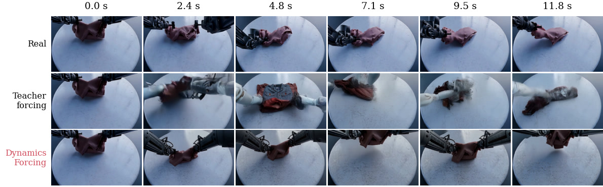
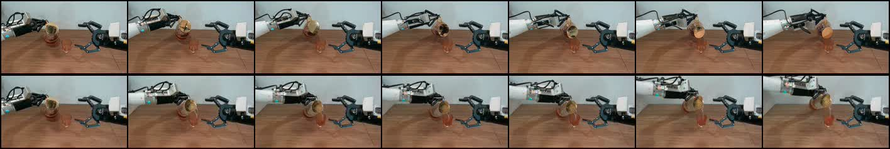

# Dynamics Forcing

Dynamics Forcing 是面向因果视频世界模型的 LoRA 训练方案。训练以真实视频作为监督，通过历史加噪、自重采样和联合去噪，让模型学会在自回归生成时利用带误差的历史。训练同时使用历史引导和首帧锚定。

## 环境与权重

通过 `df.py` 训练、推理和下载模型。

安装需要 Linux、Python 3.10、支持 CUDA 12.8 的 NVIDIA 驱动，以及用于编译 FlashAttention 的 CUDA 工具包和编译器。实测机器使用 NVIDIA L20 48 GB。

```bash
python3.10 -m venv .venv
source .venv/bin/activate
python -m pip install -r requirements.txt
python -m pip install flash-attn==2.8.3 --no-build-isolation
```

## 下载模型权重

```bash
python df.py --download
```

此命令下载 [Astronex-World 权重](https://huggingface.co/Astronex-Lab/Astronex-World)，生成 `weights/Astronex-World/causal-generator.pt`，并将 VAE 和文本编码器文件下载到 `assets/`。已有模型快照可用 `--from-local DIR`。安装 `modelscope` 后，可用 `--source modelscope --repo OWNER/MODEL` 指定镜像。

## 数据下载与接入

下表是本次实验实际用到的数据。条数按重采样后的训练清单统计，包含重复采样。

| 数据集 | 训练条数 | 下载入口 |
| --- | ---: | --- |
| RoVid-X | 13,441 | [Hugging Face](https://huggingface.co/datasets/DAGroup-PKU/RoVid-X) |
| EgoVerse | 3,876 | [官方下载指南](https://github.com/GaTech-RL2/EgoVerse#readme) |
| EgoDex | 3,807 | [Apple 下载指南](https://github.com/apple-aiml-research/ml-egodex#dataset-access-and-download) |

解压所需视频，将标注中的任务指令写成同目录、同名的 UTF-8 文本，例如 `clip.mp4` 对应 `clip.txt`。安装 FFmpeg 后，在项目根目录运行：

```bash
python df.py --train --prepare-data --input datasets/RoVid-X datasets/EgoVerse datasets/EgoDex \
  --output datasets/robot-video
```

脚本递归搜索视频，重采样到 24 fps，保存前 285 帧，并生成训练清单、验证清单和 `receipt.json`。无指令或不足 285 帧的片段会跳过。输入每个源录制只保留一个片段时，脚本按源录制划分训练和验证。训练时将输出目录传给 `--data-root`。

## 训练

使用准备好的 Astronex-World 块因果生成器检查点初始化训练。

```bash
python df.py --train \
  --data-root datasets/robot-video --output outputs/train
```

### 分布式训练

`--batch-size N` 设置每张 GPU 每个微批次的视频数。有效 batch 等于单卡 batch × GPU 数 × 梯度累积步数。用 `--epochs N` 设置总训练轮数，`--save-every N` 表示每 N 次优化器更新保存一次，最终一步也会保存。使用梯度累积时，训练长度向上取整到完整的优化器更新。

```bash
python df.py --train --data-root datasets/robot-video --output outputs/train \
  --batch-size 1 --epochs 5 --save-every 100 --gpus 2 --nvlink
```

每张 GPU 保存一份模型，并独立读取各自的数据。训练通过 NCCL 同步 LoRA 梯度。`--nvlink` 在硬件支持时启用 NVLink 点对点传输。

## 推理

用 `--image` 指定参考图，或用 `--video` 指定参考视频。默认是每块 21 个 Euler 步、6 块、文本引导 5、锚点 0、种子 1000。

```bash
python df.py --infer --checkpoint weights/dynamics-forcing.pt \
  --video reference.mp4 --prompt "Pour the water from the held golden kettle into the nearby cup" \
  --out outputs/pouring-g5-a0.mp4
```

## 论文示例





## 训练方法

生成器以 8 个潜帧为一块，采用块因果注意力和跨块 KV 缓存。每个块根据首帧、文本指令和此前生成的块预测后续变化。训练冻结 5B 主干，以约 77 小时视频拟合 rank-64 LoRA。

- **历史加噪**：扰动历史块，减小训练时干净历史与推理时生成历史之间的差距。
- **自重采样**：以 0.7 的概率用模型自身进行 3 步无梯度去噪，使训练历史包含模型会实际产生的错误。
- **联合去噪**：以 0.5 的概率使用 3 块窗口，较早的块噪声更低，以保留历史信息，同时模拟生成边界处的误差。
- **训练期引导**：历史弱化噪声为 0.5，首帧锚点弱化噪声为 0.8，引导训练权重为 1。真实视频块仍是监督目标。

## 论文结果

在留出的机械臂视频上，相对 teacher forcing，DINOv2 语义相似度从 0.717 提升至 0.804，局部特征相似度从 0.613 提升至 0.733。排除镜头运动后，VBench-I2V 总分相对 Astronex-World 从 85.15 提升至 90.02。原 VBench 评测入口使用 21 步。上面的 8 步命令用于单样本推理验证。

## VBench-I2V 成绩

| 模型 | 总分（排除镜头运动） |
| --- | ---: |
| Astronex-World | 85.15 |
| Dynamics Forcing | **90.02** |

## 许可证

Dynamics Forcing 采用 [Apache 2.0](LICENSE) 许可证。
